# java项目ssm咖啡馆管理系统java毕业设计

> 🎓 **计算机毕业设计 · java项目ssm咖啡馆管理系统java毕业设计**
>
> 本仓库只放**项目介绍 + 运行截图**（截图是站点带水印的原图，存在仓库 `images/` 里）。
>
> 👉 **完整可运行源码 / 数据库脚本 / 部署文档：[点我获取](https://geekcode.top/archives/java%E9%A1%B9%E7%9B%AEssm%E5%92%96%E5%95%A1%E9%A6%86%E7%AE%A1%E7%90%86%E7%B3%BB%E7%BB%9Fjava%E6%AF%95%E4%B8%9A%E8%AE%BE%E8%AE%A1?utm_source=github)**
>
> 💬 咨询微信：**ir9372**　|　🌐 更多项目：[极客代码 geekcode.top](https://geekcode.top/?utm_source=github)
>
> 📌 项目详情页：<https://geekcode.top/archives/java%E9%A1%B9%E7%9B%AEssm%E5%92%96%E5%95%A1%E9%A6%86%E7%AE%A1%E7%90%86%E7%B3%BB%E7%BB%9Fjava%E6%AF%95%E4%B8%9A%E8%AE%BE%E8%AE%A1?utm_source=github>

<table><td width="230" align="center"> <b>扫码加微信 ir9372</b></td><td valign="middle">📦 源码 = 项目介绍 + 全部运行截图 + 数据库 + 部署文档 👉 点上方任意截图，直接跳到 <b>极客代码 geekcode.top</b> 详情页</td></table>

---

<h1>java项目_ssm咖啡馆管理系统_java毕业设计</h1>
<h2>项目概述</h2>

本项目是一套面向咖啡馆经营场景的 Java 毕业设计系统，项目名称为“咖啡馆管理系统”，采用纯后端接口（pure-api）形态实现，通过 REST 风格的接口向前端界面或调用方提供业务数据与服务能力。系统以咖啡商品为核心业务对象，围绕咖啡类型与咖啡信息的分类管理、购物车选购、订单交易、收货地址维护、客户咨询等环节构建完整的业务闭环，同时提供用户、客户、员工三类人员数据的管理能力以及文件上传、系统配置等通用支撑功能。

系统的核心功能包括：咖啡类型与咖啡信息管理、购物车管理、订单管理、地址管理、客户咨询（聊天）管理、用户管理、客户管理、员工管理、文件上传与系统配置管理。适用人群为中小型咖啡馆经营者、门店员工以及需要完成 Java Web 方向毕业设计的学生，可作为咖啡馆线上选购与后台数据管理的原型系统，也可作为教学与二次开发的基础工程。

技术架构上，系统基于 Spring 生态的 Web MVC 框架构建分层结构，持久层采用 MyBatis-Plus 完成对象关系映射与通用 CRUD，数据源与连接池采用 Druid，构建与依赖管理使用 Maven，测试采用 JUnit。

<h2>技术架构</h2>
<h3>整体架构</h3>

系统为纯 API 后端工程，不包含内置的前台页面路由与后台页面路由，所有界面均以接口调用的方式与后端交互。工程内部遵循经典的分层设计：控制层负责请求接收与参数解析，业务层负责业务规则组织，持久层借助 MyBatis-Plus 完成数据访问，数据库承载最终数据存储。依赖清单中包含 spring-core、spring-context、spring-context-support、spring-beans、spring-aop、spring-tx、spring-jdbc、spring-web、spring-webmvc，说明系统以 Spring 容器为运行基础，使用 spring-webmvc 提供 MVC 请求分发能力，使用 spring-tx 承担事务管理，使用 spring-jdbc 支撑数据源与 JDBC 访问。

<a href="https://geekcode.top/archives/java%E9%A1%B9%E7%9B%AEssm%E5%92%96%E5%95%A1%E9%A6%86%E7%AE%A1%E7%90%86%E7%B3%BB%E7%BB%9Fjava%E6%AF%95%E4%B8%9A%E8%AE%BE%E8%AE%A1?utm_source=github" title="查看完整源码">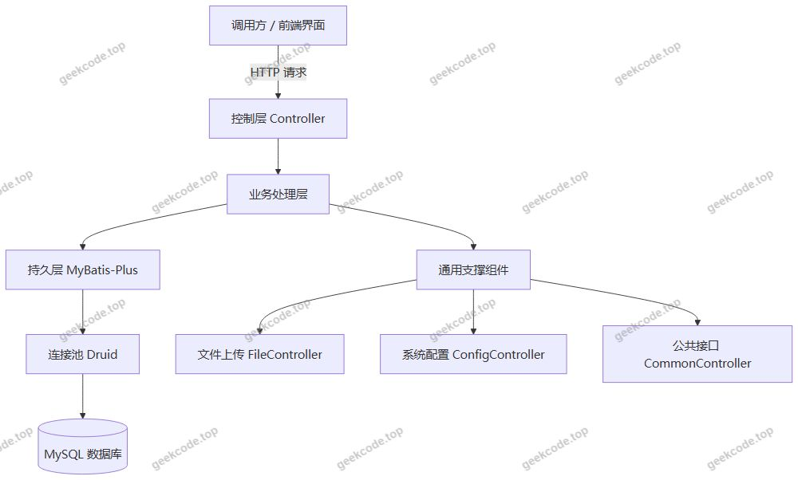</a>

<h3>数据库设计要点</h3>

数据库设计围绕人员数据、商品数据与交易数据三条主线展开：

<ul>
<li>人员主线：由用户（UserController）、客户（KehuController）、员工（YuangongController）三类人员数据构成，分别承载系统账号、客户档案与门店员工档案。</li>
<li>商品主线：采用“类型—信息”两级结构，咖啡类型（KafeileixingController）作为分类维度，咖啡信息（KafeixinxiController）作为具体商品条目，形成一对多的分类归属关系。</li>
<li>交易主线：购物车（CartController）承担下单前的临时选购数据，订单（OrdersController）承担成交记录，地址（AddressController）承担收货信息，三者均与用户数据关联。</li>
<li>交互支撑：聊天（ChatController）承载客户咨询会话数据，配置（ConfigController）承载系统参数，文件（FileController）承载上传文件记录。</li>
</ul>
<h3>核心技术选型理由</h3>
<ul>
<li>MyBatis-Plus：在 MyBatis 基础上提供通用 Mapper 与条件构造器，减少单表增删改查的重复代码，适合本项目中大量结构相似的基础数据管理接口。</li>
<li>Druid：作为数据库连接池提供连接复用与监控能力，便于观察 SQL 执行与连接使用情况，适配中小规模业务系统的运维需要。</li>
<li>Spring MVC：基于 spring-web 与 spring-webmvc 提供注解式控制器与请求映射，使每个业务模块对应独立控制器，职责边界清晰。</li>
<li>Maven + JUnit：使用 Maven 统一管理依赖版本，使用 JUnit 编写单元测试，保障基础代码质量。</li>
</ul>
<h2>功能模块</h2>
<h3>用户端（前台）</h3>
<table>
<thead>
<tr>
<th>模块</th>
<th>对应控制器</th>
<th>功能说明</th>
</tr>
</thead>
<tbody><tr>
<td>登录</td>
<td>UserController</td>
<td>用户身份认证入口，提供账号登录能力</td>
</tr>
<tr>
<td>咖啡信息</td>
<td>KafeixinxiController</td>
<td>浏览咖啡商品信息，查看商品列表与详情</td>
</tr>
<tr>
<td>购物车</td>
<td>CartController</td>
<td>将咖啡商品加入购物车、查看购物车内容、调整选购数据</td>
</tr>
<tr>
<td>我的订单</td>
<td>OrdersController</td>
<td>查看本人订单记录与订单状态信息</td>
</tr>
<tr>
<td>我的地址</td>
<td>AddressController</td>
<td>维护个人收货地址信息</td>
</tr>
<tr>
<td>个人中心</td>
<td>UserController</td>
<td>查看与维护个人账号资料</td>
</tr>
<tr>
<td>客服咨询</td>
<td>ChatController</td>
<td>与客服进行在线咨询会话</td>
</tr>
</tbody></table>
<h3>管理端（后台）</h3>
<table>
<thead>
<tr>
<th>模块</th>
<th>对应控制器</th>
<th>功能说明</th>
</tr>
</thead>
<tbody><tr>
<td>用户管理</td>
<td>UserController</td>
<td>对系统用户数据的新增、查询、修改、删除等维护操作</td>
</tr>
<tr>
<td>客户管理</td>
<td>KehuController</td>
<td>维护客户档案数据</td>
</tr>
<tr>
<td>员工管理</td>
<td>YuangongController</td>
<td>维护门店员工档案数据</td>
</tr>
<tr>
<td>咖啡类型管理</td>
<td>KafeileixingController</td>
<td>维护咖啡分类数据，为咖啡信息提供分类归属</td>
</tr>
<tr>
<td>咖啡信息管理</td>
<td>KafeixinxiController</td>
<td>维护咖啡商品数据，包括上架信息与分类关联</td>
</tr>
<tr>
<td>订单管理</td>
<td>OrdersController</td>
<td>查看与处理全量订单数据</td>
</tr>
<tr>
<td>客服咨询管理</td>
<td>ChatController</td>
<td>查看与回复客户咨询会话</td>
</tr>
<tr>
<td>文件管理</td>
<td>FileController</td>
<td>提供文件上传与文件资源访问能力</td>
</tr>
<tr>
<td>系统配置</td>
<td>ConfigController</td>
<td>维护系统运行参数配置</td>
</tr>
<tr>
<td>公共接口</td>
<td>CommonController</td>
<td>提供跨模块共用的基础数据与通用能力</td>
</tr>
</tbody></table>

<a href="https://geekcode.top/archives/java%E9%A1%B9%E7%9B%AEssm%E5%92%96%E5%95%A1%E9%A6%86%E7%AE%A1%E7%90%86%E7%B3%BB%E7%BB%9Fjava%E6%AF%95%E4%B8%9A%E8%AE%BE%E8%AE%A1?utm_source=github" title="查看完整源码">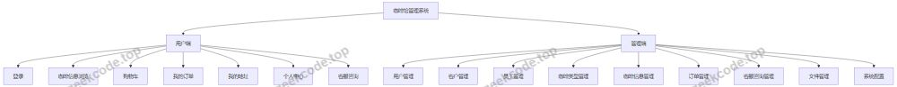</a>

<h2>用户角色与权限</h2>

系统依据控制器结构划分为两类身份主体，并配合客户档案数据形成完整的人员体系。

<h3>普通用户</h3>

面向咖啡馆消费者的前台使用身份，具备以下功能权限：

<ul>
<li>登录认证：通过用户接口完成账号登录。</li>
<li>咖啡信息浏览：查看咖啡商品列表与详情。</li>
<li>购物车操作：将咖啡商品加入购物车、查看与维护购物车内容。</li>
<li>订单操作：提交订单并查看“我的订单”记录。</li>
<li>地址管理：在“我的地址”中维护个人收货地址。</li>
<li>个人中心：查看与维护本人账号资料。</li>
<li>客服咨询：发起并参与在线咨询会话。</li>
</ul>
<h3>员工（管理端）</h3>

面向门店员工与管理人员的后台使用身份，具备以下功能权限：

<ul>
<li>用户管理：维护系统用户数据。</li>
<li>客户管理：维护客户档案数据。</li>
<li>员工管理：维护员工档案数据。</li>
<li>咖啡类型管理：维护咖啡分类数据。</li>
<li>咖啡信息管理：维护咖啡商品数据。</li>
<li>订单管理：查看与处理订单数据。</li>
<li>客服咨询管理：查看并回复客户咨询会话。</li>
<li>文件管理：上传文件并获取文件访问地址。</li>
<li>系统配置：维护系统运行参数。</li>
</ul>
<h3>客户（业务数据角色）</h3>

客户数据通过客户管理模块维护，作为系统中的客户档案主体，与用户、员工共同构成人员数据体系。客户档案本身为数据对象，不构成独立的登录身份。

<h2>项目特色与创新点</h2>
<ul>
<li>业务闭环完整：以咖啡类型与咖啡信息的两级商品结构为基础，串联购物车、订单、地址、客服咨询等环节，覆盖从选购到售后咨询的完整消费链路。</li>
<li>接口化设计清晰：采用纯 API 形态，控制器按业务域独立划分，共 12 个控制器分别对应人员、商品、交易与支撑能力，便于前端多端复用与后续扩展。</li>
<li>通用能力内聚：文件上传、系统配置、公共接口独立成模块，避免通用逻辑散落在各业务控制器中，降低耦合度。</li>
<li>持久层高效：借助 MyBatis-Plus 的通用 CRUD 能力，将大量基础数据维护接口的实现成本控制在较低水平，使开发重心集中在业务规则上。</li>
<li>数据源可观测：引入 Druid 连接池，为数据库访问提供连接复用与运行监控能力，便于教学演示与问题排查。</li>
<li>分类化商品管理：通过咖啡类型与咖啡信息的分离设计，支持按分类组织商品，便于后续扩展商品维度与分类运营。</li>
</ul>
<h2>部署环境</h2>
<table>
<thead>
<tr>
<th>类别</th>
<th>要求</th>
</tr>
</thead>
<tbody><tr>
<td>JDK</td>
<td>需安装与所选 Spring 框架版本相匹配的 JDK 运行环境</td>
</tr>
<tr>
<td>构建工具</td>
<td>Maven，用于依赖管理与工程构建</td>
</tr>
<tr>
<td>数据库</td>
<td>MySQL，作为业务数据存储</td>
</tr>
<tr>
<td>连接池</td>
<td>Druid，随工程依赖自动引入，需在配置中提供数据库连接参数</td>
</tr>
<tr>
<td>Web 容器</td>
<td>具备 Servlet 容器能力的运行环境，用于承载 spring-webmvc 请求分发</td>
</tr>
<tr>
<td>测试框架</td>
<td>JUnit，用于运行单元测试</td>
</tr>
<tr>
<td>调用工具</td>
<td>Postman 或浏览器等 HTTP 调用工具，用于接口调试与验证</td>
</tr>
</tbody></table>

部署时需先完成数据库创建与初始化，再在工程配置中填写数据库连接地址、账号与密码，随后通过 Maven 完成依赖拉取与打包，最后启动服务并通过接口地址进行访问验证。

<h2>五、技术特性</h2>
<ul>
<li>使用 MyBatis-Plus 简化数据访问层开发</li>
</ul>
<h2>六、功能模块截图</h2>
<h3>后台管理端</h3>
<h4>页面-登录</h4>

<a href="https://geekcode.top/archives/java%E9%A1%B9%E7%9B%AEssm%E5%92%96%E5%95%A1%E9%A6%86%E7%AE%A1%E7%90%86%E7%B3%BB%E7%BB%9Fjava%E6%AF%95%E4%B8%9A%E8%AE%BE%E8%AE%A1?utm_source=github" title="查看完整源码">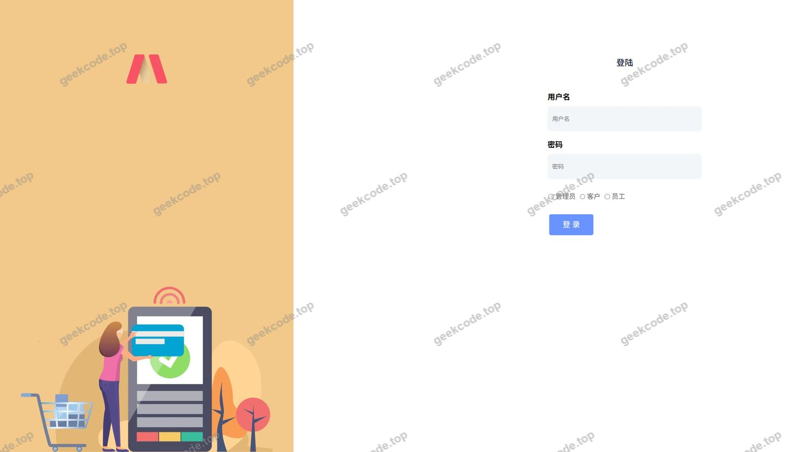</a>

<h4>页面-订单</h4>

<a href="https://geekcode.top/archives/java%E9%A1%B9%E7%9B%AEssm%E5%92%96%E5%95%A1%E9%A6%86%E7%AE%A1%E7%90%86%E7%B3%BB%E7%BB%9Fjava%E6%AF%95%E4%B8%9A%E8%AE%BE%E8%AE%A1?utm_source=github" title="查看完整源码">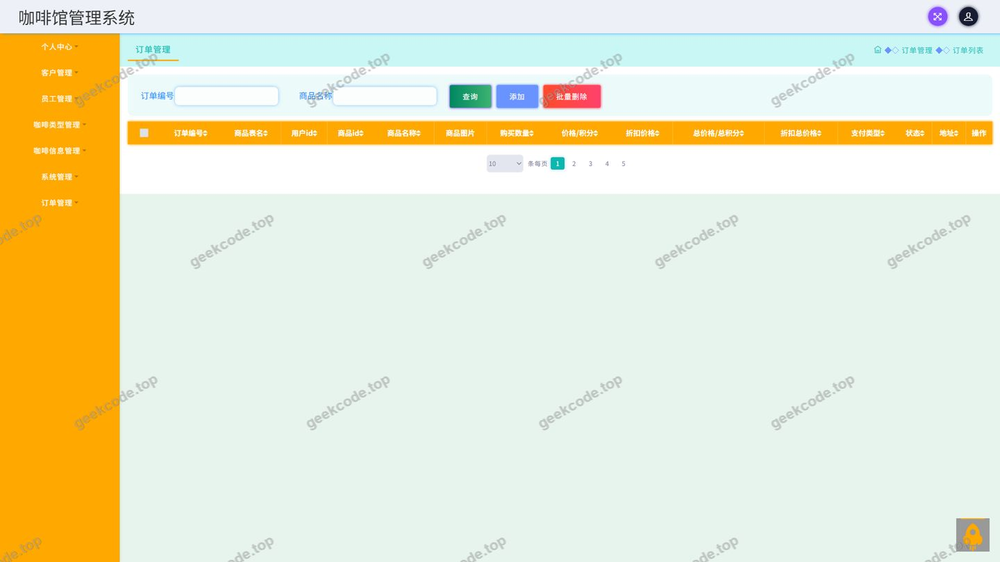</a>

<h4>页面-购物车</h4>

<a href="https://geekcode.top/archives/java%E9%A1%B9%E7%9B%AEssm%E5%92%96%E5%95%A1%E9%A6%86%E7%AE%A1%E7%90%86%E7%B3%BB%E7%BB%9Fjava%E6%AF%95%E4%B8%9A%E8%AE%BE%E8%AE%A1?utm_source=github" title="查看完整源码">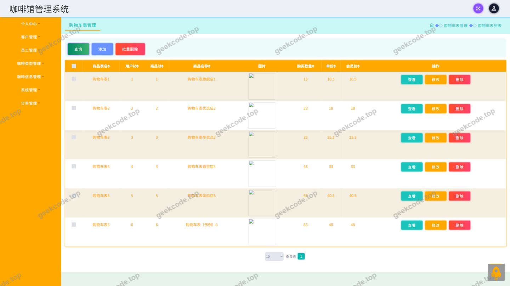</a>

<h4>页面-咖啡类型</h4>

<a href="https://geekcode.top/archives/java%E9%A1%B9%E7%9B%AEssm%E5%92%96%E5%95%A1%E9%A6%86%E7%AE%A1%E7%90%86%E7%B3%BB%E7%BB%9Fjava%E6%AF%95%E4%B8%9A%E8%AE%BE%E8%AE%A1?utm_source=github" title="查看完整源码">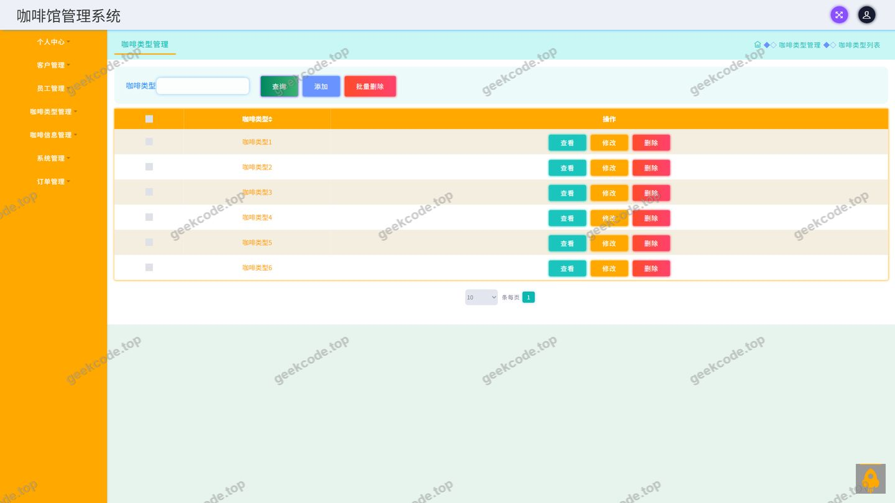</a>

<h4>页面-咖啡信息</h4>

<a href="https://geekcode.top/archives/java%E9%A1%B9%E7%9B%AEssm%E5%92%96%E5%95%A1%E9%A6%86%E7%AE%A1%E7%90%86%E7%B3%BB%E7%BB%9Fjava%E6%AF%95%E4%B8%9A%E8%AE%BE%E8%AE%A1?utm_source=github" title="查看完整源码">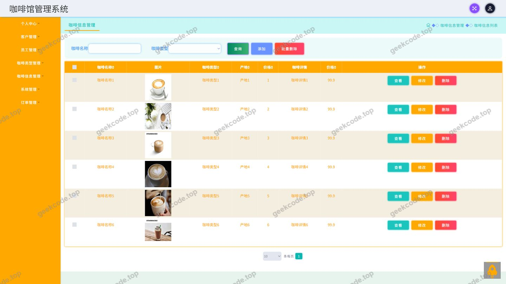</a>

<h4>页面-客服咨询</h4>

<a href="https://geekcode.top/archives/java%E9%A1%B9%E7%9B%AEssm%E5%92%96%E5%95%A1%E9%A6%86%E7%AE%A1%E7%90%86%E7%B3%BB%E7%BB%9Fjava%E6%AF%95%E4%B8%9A%E8%AE%BE%E8%AE%A1?utm_source=github" title="查看完整源码">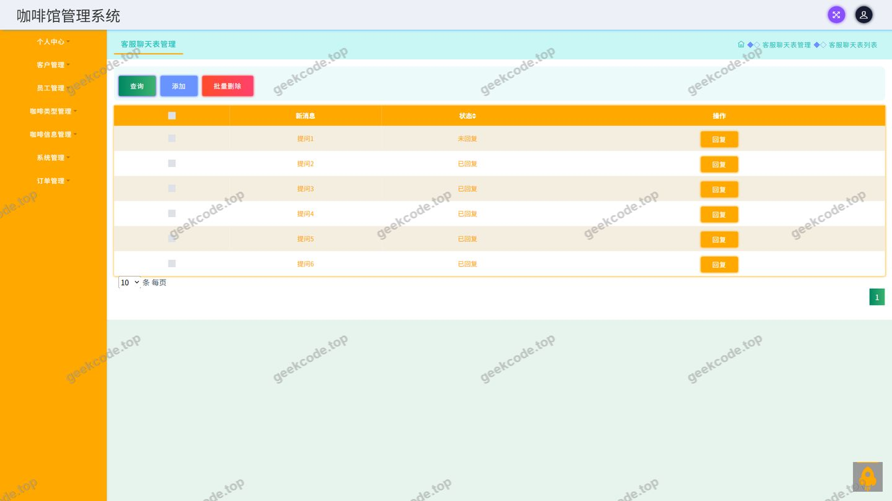</a>

<h4>页面-客户</h4>

<a href="https://geekcode.top/archives/java%E9%A1%B9%E7%9B%AEssm%E5%92%96%E5%95%A1%E9%A6%86%E7%AE%A1%E7%90%86%E7%B3%BB%E7%BB%9Fjava%E6%AF%95%E4%B8%9A%E8%AE%BE%E8%AE%A1?utm_source=github" title="查看完整源码">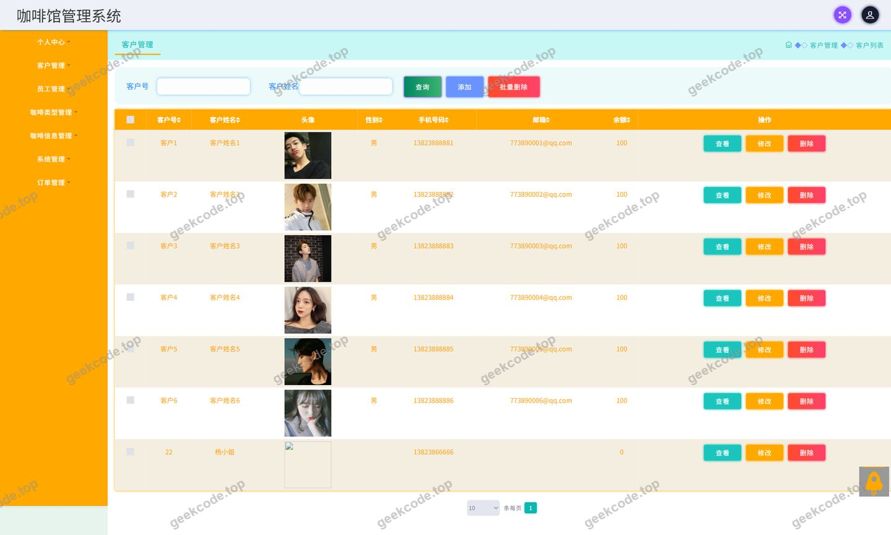</a>

<h4>页面-用户</h4>

<a href="https://geekcode.top/archives/java%E9%A1%B9%E7%9B%AEssm%E5%92%96%E5%95%A1%E9%A6%86%E7%AE%A1%E7%90%86%E7%B3%BB%E7%BB%9Fjava%E6%AF%95%E4%B8%9A%E8%AE%BE%E8%AE%A1?utm_source=github" title="查看完整源码">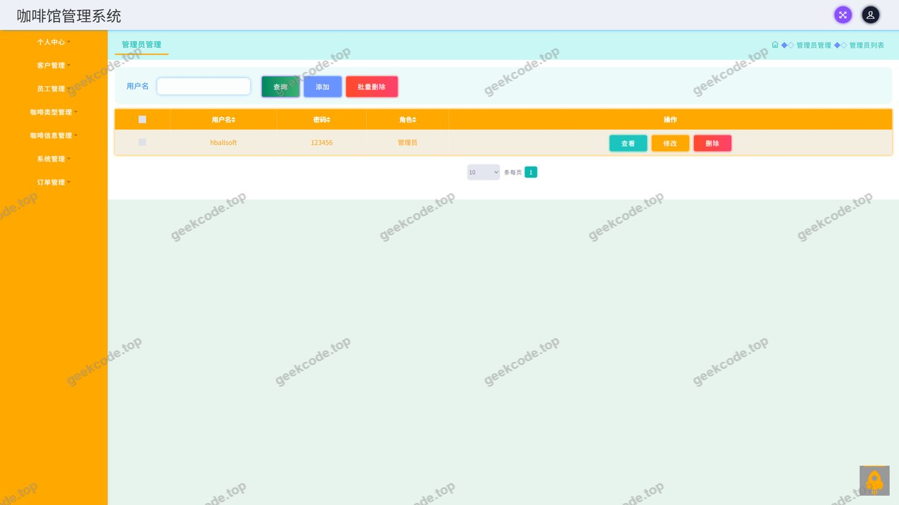</a>

<h4>页面-员工</h4>

<a href="https://geekcode.top/archives/java%E9%A1%B9%E7%9B%AEssm%E5%92%96%E5%95%A1%E9%A6%86%E7%AE%A1%E7%90%86%E7%B3%BB%E7%BB%9Fjava%E6%AF%95%E4%B8%9A%E8%AE%BE%E8%AE%A1?utm_source=github" title="查看完整源码">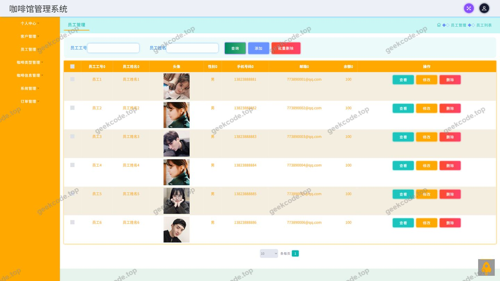</a>

---

## 获取完整源码

| 项目 | 说明 |
| --- | --- |
| 项目名 | java项目ssm咖啡馆管理系统java毕业设计 |
| 运行截图 | 本文 11 张（站点带水印原图，仓库 `images/` 目录） |
| 完整源码 | [https://geekcode.top/archives/java%E9%A1%B9%E7%9B%AEssm%E5%92%96%E5%95%A1%E9%A6%86%E7%AE%A1%E7%90%86%E7%B3%BB%E7%BB%9Fjava%E6%AF%95%E4%B8%9A%E8%AE%BE%E8%AE%A1?utm_source=github](https://geekcode.top/archives/java%E9%A1%B9%E7%9B%AEssm%E5%92%96%E5%95%A1%E9%A6%86%E7%AE%A1%E7%90%86%E7%B3%BB%E7%BB%9Fjava%E6%AF%95%E4%B8%9A%E8%AE%BE%E8%AE%A1?utm_source=github) |
| 咨询微信 | **ir9372**（备注：jingpin-yuanma） |
| 更多项目 | [极客代码 geekcode.top](https://geekcode.top/?utm_source=github) |

> 需要源码、部署、改配置、跑不起来等问题，加微信 ir9372 沟通，说明项目名即可。
